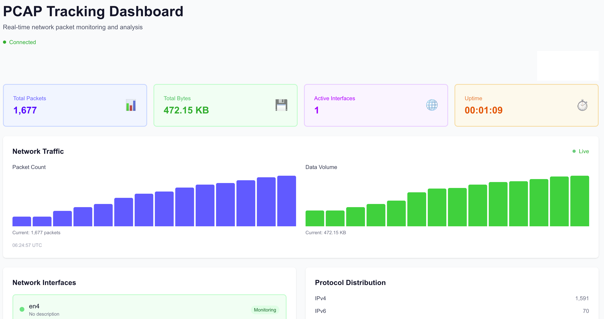

# PCAP Tracking System

A web application for tracking network packets by interface with real-time monitoring capabilities.

## Project Structure

```text
pcap-tracking/
├── backend/          # Go Gin-based backend API server
│   ├── cmd/          # Application entry point
│   ├── internal/     # Internal packages
│   ├── pkg/          # Public packages
│   └── go.mod
└── frontend/         # Next.js TypeScript React web application
    ├── src/
    ├── public/
    └── package.json
```

## Features

- Network packet capture and tracking by interface
- Real-time packet statistics monitoring
- Web-based dashboard with visualization
- RESTful API for data access
- WebSocket support for real-time updates
- Swagger API documentation

## Dashboard



The web dashboard provides real-time monitoring of network packet statistics with:

- Live packet capture statistics by interface
- Real-time network traffic visualization
- Current system time in UTC format
- Interface status and activity monitoring

## Tech Stack

### Backend

- Go 1.21+
- Gin Web Framework
- gopacket (packet capture)
- WebSocket (real-time communication)
- Swagger (API documentation)

### Frontend

- Next.js 14
- TypeScript
- React 18
- Tailwind CSS
- Chart.js (data visualization)

## Quick Start

### Backend Setup

```bash
cd backend
go mod tidy
make run
```

### Frontend Setup

```bash
cd frontend
npm install
npm run dev
```

### API Documentation

Once the backend is running, access Swagger documentation at:

```text
http://localhost:8080/swagger/index.html
```

## Development

### Backend Development

```bash
cd backend

# Install dependencies
make deps

# Run with hot reload
make dev

# Build for production
make build

# Run tests
make test
```

### Frontend Development

```bash
cd frontend

# Install dependencies
npm install

# Start development server
npm run dev

# Build for production
npm run build

# Start production server
npm start
```

## API Endpoints

- `GET /api/v1/health` - Health check
- `GET /api/v1/interfaces` - Get available network interfaces
- `GET /api/v1/stats` - Get current packet capture statistics
- `GET /api/v1/ws` - WebSocket endpoint for real-time updates

## Testing

### Generate Test Traffic

To test the packet capture functionality, you can generate network traffic:

```bash
# Generate various types of network traffic
make traffic

# Or run the script directly
./scripts/generate_traffic.sh
```

### Monitor Logs

The backend logs are in JSON format. To reduce noise from timeout messages:

```bash
# Set log level to debug for verbose output
LOG_LEVEL=debug go run cmd/main.go

# Default info level filters out timeout messages
go run cmd/main.go
```

## Configuration

Backend configuration can be customized via `backend/config.json`:

```json
{
  "server": {
    "port": "8080",
    "host": "0.0.0.0"
  },
  "capture": {
    "interfaces": ["en0"],
    "snapLength": 1024,
    "promiscuous": true,
    "timeoutMs": 1000,
    "bufferSizeMB": 100,
    "statsInterval": 1
  }
}
```

## License

MIT License
